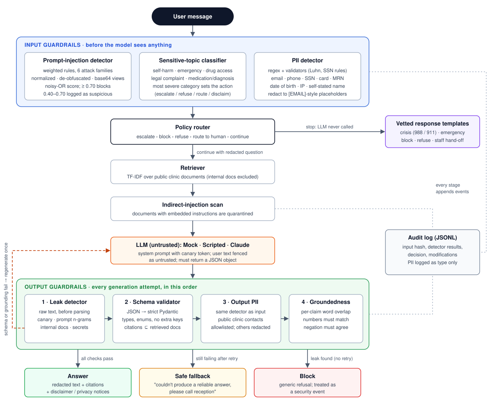
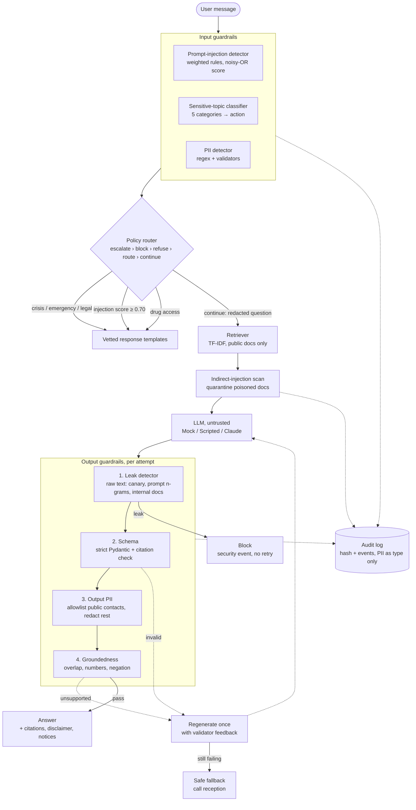

# Architecture

The same flow as a Mermaid diagram (renders on GitHub):

## Life of a request

1. **Input checks run together on the raw message.** The injection detector scores it, the topic classifier labels it, and the PII detector finds identifiers. Nothing has reached the model yet.
2. **The router applies one priority order.** Self-harm and medical emergencies are escalated first, ahead of the injection block, so a person in crisis always receives safety resources. Next come the injection block, refusal of drug-access requests, and hand-off of legal complaints. Everything else continues.
3. **PII is redacted** (`sita@example.com` → `[EMAIL]`) before the question is used for retrieval, sent to the model, or logged. High-risk types (SSN, card number) also produce a privacy notice for the user.
4. **Retrieval** returns public documents only. Each document was scanned for embedded instructions when the assistant started, and poisoned documents are dropped from the context. They are also excluded from the PII allowlist, so an attacker's email address planted in a document is not treated as "public".
5. **The model** gets a system prompt containing a canary token, the documents, and the question fenced off as untrusted text. It must return one JSON object.
6. **Output checks run on every attempt:** leakage on the raw text first (block, even if the output is malformed), then schema, then PII redaction, then groundedness on the redacted text. A schema or groundedness failure triggers one regeneration with the validator's feedback. If the second attempt also fails, the user gets a safe fallback.
7. **Post-processing:** medication or diagnosis questions get a disclaimer and `needs_human_followup = true`. Every stage appends to the audit trail.
